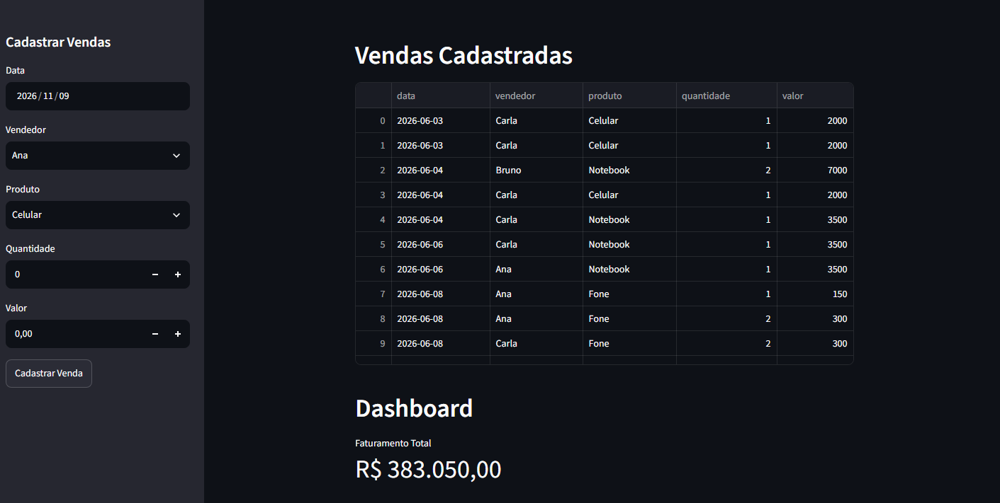
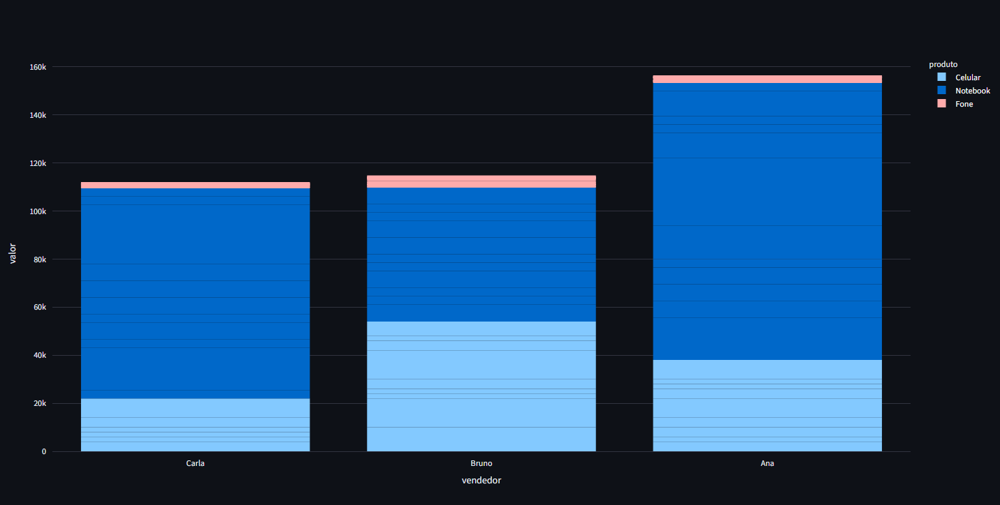
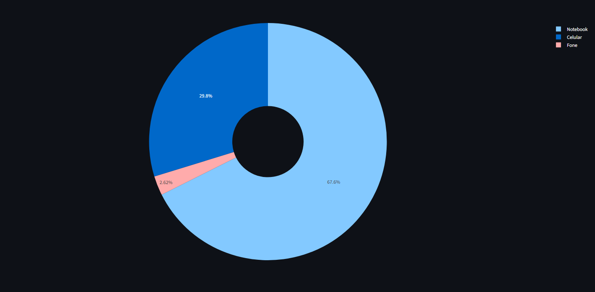
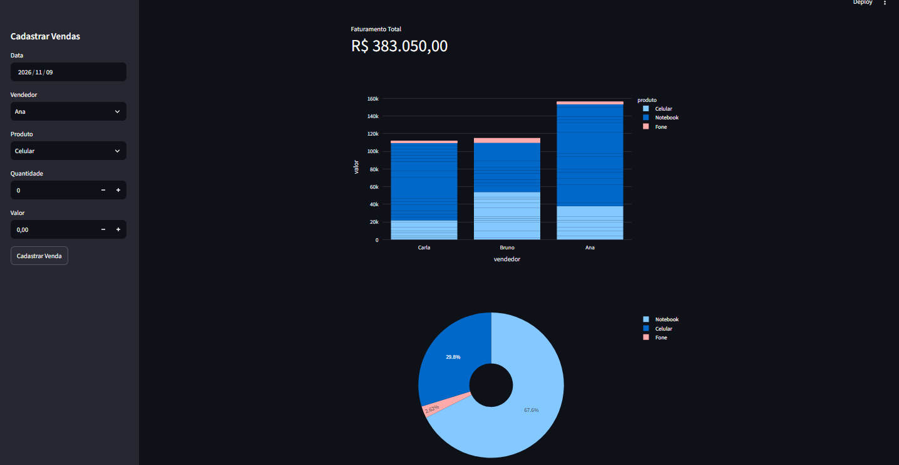
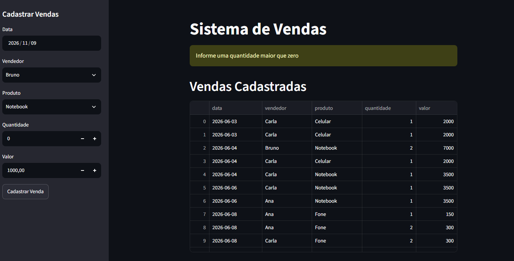
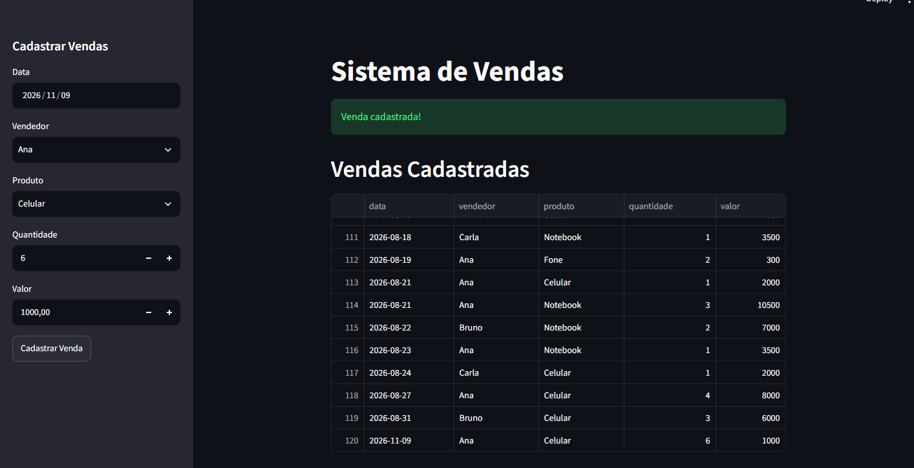

# Sistema de Vendas e Gestão

Sistema web simples, feito em Python com Streamlit, para cadastrar vendas, consultá-las em uma tabela e acompanhar o faturamento em um dashboard com gráficos.

## Sobre o desafio

Projeto da Aula 4 do curso **Jornada Python** ("Sistema de Vendas e Gestão Online"). A proposta era criar um sistema completo para uma empresa com vendedores: registrar cada venda (data, vendedor, produto, quantidade e valor), ver todas as vendas em uma tabela e acompanhar o desempenho por meio de métricas e gráficos.

Além do que a aula pedia, fiz alguns ajustes: validação da quantidade e do valor no cadastro, faturamento exibido no formato brasileiro e correção de erros de digitação.

## Funcionalidades

- Formulário de cadastro na barra lateral: data, vendedor, produto, quantidade e valor.
- Validação: não deixa cadastrar venda com quantidade ou valor menor ou igual a zero.
- Salva cada venda no arquivo `vendas.csv`, que funciona como uma pequena base de dados local.
- Tabela interativa com todas as vendas cadastradas.
- Dashboard com o faturamento total (ex.: `R$ 383.050,00`), um gráfico de barras com as vendas por vendedor (empilhado por produto) e um gráfico de pizza com a participação de cada produto no faturamento.

## Tecnologias usadas

- Python 3.13
- [Streamlit](https://docs.streamlit.io/) para a interface web
- [Pandas](https://pandas.pydata.org/docs/) para ler e salvar os dados
- [Plotly Express](https://plotly.com/python/) para os gráficos

## Como rodar

Você precisa ter o Python instalado. Os comandos abaixo são para o terminal do Windows (PowerShell) ou o terminal do VS Code.

1. Baixe o projeto (botão **Code > Download ZIP** aqui no GitHub) e extraia a pasta.
2. Abra o terminal **dentro da pasta do projeto** (o caminho precisa ser a pasta onde está o `main.py`).
3. Instale as bibliotecas, em uma linha só:

   ```
   pip install -r requirements.txt
   ```

4. Inicie o sistema:

   ```
   streamlit run main.py
   ```

   Se o Windows disser que o comando `streamlit` não foi encontrado, use:

   ```
   py -m streamlit run main.py
   ```

5. O navegador abre sozinho. Se não abrir, acesse o endereço mostrado no terminal (normalmente `http://localhost:8501`).

> O sistema precisa ser iniciado de dentro da pasta do projeto, porque procura o `vendas.csv` ali.

> Cada venda cadastrada é **gravada no `vendas.csv`**. Se quiser voltar à base original, baixe o arquivo de novo aqui do GitHub.

## Testes

O projeto não tem testes automatizados. Eu testei manualmente na própria tela:

- Abrir o sistema: tabela e dashboard carregam com as 120 vendas da base (faturamento de R$ 383.050,00).
- Cadastrar com quantidade 0: aparece o aviso "Informe uma quantidade maior que zero" e nada é gravado.
- Cadastrar uma venda válida: aparece "Venda cadastrada!" e a venda entra no fim da tabela.

## Prints

**Página inicial**



**Gráfico de vendas por vendedor**



**Gráfico de participação por produto**



**Dashboard completo**



**Aviso de quantidade inválida**



**Venda cadastrada com sucesso**



## Estrutura do projeto

```
sistema-de-vendas/
├── main.py            # código do sistema
├── vendas.csv         # base de dados (vendas)
├── requirements.txt   # bibliotecas necessárias
├── imagens/           # prints usados neste README
└── README.md
```

## Limitações

- Usar um arquivo CSV como base de dados é uma solução simples, boa para estudo. Não serve para várias pessoas cadastrando ao mesmo tempo e não tem controle de acesso.
- Os vendedores e os produtos estão fixos no código. Os dados da base são fictícios.
- Se o sistema for publicado online (por exemplo, no Streamlit Cloud), as vendas cadastradas pelo site podem se perder quando o aplicativo reiniciar, porque o arquivo no servidor é temporário. Para uso real, o ideal seria um banco de dados.
